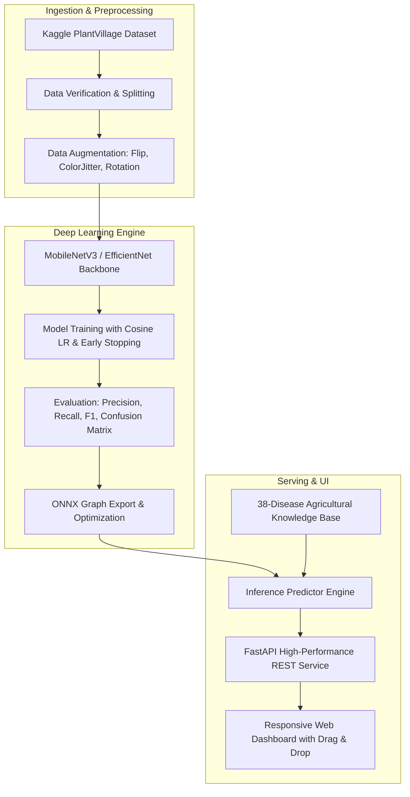

# PhytoAI: Production Plant Disease Detection & Agronomic Advisory System

[](https://github.com/xoUtkarsh/Plant-Disease-Detection/actions/workflows/ci.yml)
[](https://fastapi.tiangolo.com)
[](https://pytorch.org)
[](https://onnxruntime.ai)
[](https://www.docker.com)
[](LICENSE)

An end-to-end, production-grade computer vision pipeline and deployable web application for automated crop disease diagnosis. The system classifies **38 distinct foliage conditions across 14 agricultural crops** with high precision and delivers instant, actionable treatment recommendations—including biological/organic remedies, chemical fungicides/bactericides, visual symptom guides, and cultural prevention strategies.

---

## Architecture Overview



---

## Supported Crops & Pathogens (38 Classes)

The system covers 14 major agricultural crops:

| Crop | Supported Conditions & Pathogens |
| :--- | :--- |
| **Apple** | Apple Scab, Black Rot, Cedar Apple Rust, Healthy |
| **Blueberry** | Healthy |
| **Cherry** | Powdery Mildew, Healthy |
| **Corn (Maize)** | Cercospora Gray Leaf Spot, Common Rust, Northern Leaf Blight, Healthy |
| **Grape** | Black Rot, Esca (Black Measles), Leaf Blight (Isariopsis), Healthy |
| **Orange** | Citrus Greening (Huanglongbing - HLB) |
| **Peach** | Bacterial Spot, Healthy |
| **Pepper Bell** | Bacterial Spot, Healthy |
| **Potato** | Early Blight, Late Blight, Healthy |
| **Raspberry** | Healthy |
| **Soybean** | Healthy |
| **Squash** | Powdery Mildew |
| **Strawberry** | Leaf Scorch, Healthy |
| **Tomato** | Bacterial Spot, Early Blight, Late Blight, Leaf Mold, Septoria Leaf Spot, Spider Mites, Target Spot, Yellow Leaf Curl Virus (TYLCV), Mosaic Virus (ToMV), Healthy |

---

## Project Structure

```
Plant-Disease-Detection/
├── .github/workflows/ci.yml         # Automated GitHub Actions test & build pipeline
├── configs/
│   ├── train_config.yaml            # Model hyperparameters & training configurations
│   └── api_config.yaml              # Inference & server host/port settings
├── data/
│   ├── raw/                         # Raw PlantVillage image dataset (gitignored)
│   ├── processed/                   # Train/Val/Test splits
│   └── sample_images/               # Bundled sample leaves for 1-click UI demos
├── src/
│   ├── constants.py                 # 38 class names, ImageNet normalization, label maps
│   ├── data/
│   │   ├── download.py              # Automated Kaggle API dataset downloader
│   │   └── dataset.py               # PyTorch dataset & augmentation loader
│   ├── models/
│   │   ├── architecture.py          # MobileNetV3-Large, ResNet50, EfficientNet, Custom CNN
│   │   ├── train.py                 # Modular training loop with early stopping & metrics
│   │   ├── evaluate.py              # Precision, Recall, F1, and confusion matrix exporter
│   │   └── export.py                # PyTorch to ONNX graph serialization
│   ├── inference/
│   │   ├── predictor.py             # Dual PyTorch / ONNX inference engine
│   │   └── disease_catalog.py       # Comprehensive 38-class agronomic advisory database
│   └── utils/
│       └── logger.py                # Formatted structured logging
├── app/
│   ├── main.py                      # FastAPI application entrypoint & lifecycle manager
│   ├── schemas.py                   # Pydantic v2 schemas for request/response validation
│   ├── routes/
│   │   ├── health.py                # Health checks & system telemetry
│   │   ├── predict.py               # /api/v1/predict multipart image inference
│   │   └── catalog.py               # /api/v1/diseases catalog search & filtering
│   ├── templates/
│   │   └── index.html               # Responsive diagnostic web dashboard (Tailwind)
│   └── static/                      # Static assets & sample leaves
├── scripts/
│   └── create_sample_leaves.py      # Generates synthetic test leaves for offline verification
├── tests/
│   ├── test_constants.py            # Knowledge base and constants tests
│   ├── test_model.py                # Architecture forward pass tests
│   └── test_api.py                  # End-to-end FastAPI endpoint tests
├── Dockerfile                       # Multi-stage production container
├── docker-compose.yml               # Container orchestration
├── requirements.txt                 # Core production dependencies
└── requirements-dev.txt             # Development and testing tools
```

---

## Quickstart Guide

### 1. Local Environment Setup

```bash
# Clone the repository
git clone https://github.com/xoUtkarsh/Plant-Disease-Detection.git
cd Plant-Disease-Detection

# Create and activate virtual environment
python -m venv .venv
# On Windows:
.venv\Scripts\activate
# On Linux/macOS:
source .venv/bin/activate

# Install dependencies
pip install -r requirements.txt
pip install -r requirements-dev.txt

# Generate sample demo leaves
python scripts/create_sample_leaves.py
```

### 2. Launch the Web Application

```bash
uvicorn app.main:app --host 0.0.0.0 --port 8000 --reload
```

* **Web UI Dashboard:** Open `http://localhost:8000` in your browser.
* **Interactive OpenAPI Docs:** Open `http://localhost:8000/docs`.
* **Health Endpoint:** Open `http://localhost:8000/health`.

---

## Docker Deployment

To run in a containerized production environment:

```bash
# Build and run using Docker Compose
docker compose up --build -d

# Check service health
curl -f http://localhost:8000/health
```

---

## Machine Learning Pipeline

### 1. Dataset Ingestion (Kaggle)
Ensure your `kaggle.json` credentials are placed in the project root or `~/.kaggle/`:
```bash
python -m src.data.download
```

### 2. Train Model
Train a lightweight MobileNetV3-Large or ResNet model with cosine learning rate scheduling and early stopping:
```bash
python -m src.models.train --config configs/train_config.yaml
```

### 3. Evaluate Model
Compute top-1 accuracy, per-class precision/recall, and generate the confusion matrix:
```bash
python -m src.models.evaluate --model models/plant_disease_model.pth
```

### 4. Export to ONNX
Export trained PyTorch weights to an ONNX graph for ultra-fast, low-latency CPU serving:
```bash
python -m src.models.export --model models/plant_disease_model.pth --output models/plant_disease_model.onnx
```

---

## REST API Reference

### 1. Predict Disease
`POST /api/v1/predict`

**Request:** Multipart form upload (`file`: image/jpeg, image/png, image/webp; `top_k`: integer).

**Example Response:**
```json
{
  "status": "success",
  "model_type": "pytorch",
  "prediction": {
    "class_index": 29,
    "class_name": "Tomato___Early_blight",
    "crop": "Tomato",
    "condition": "Early blight",
    "is_healthy": false,
    "confidence": 0.9682,
    "confidence_percentage": "96.82%",
    "severity": "Moderate"
  },
  "top_predictions": [
    {
      "class_index": 29,
      "class_name": "Tomato___Early_blight",
      "crop": "Tomato",
      "condition": "Early blight",
      "is_healthy": false,
      "confidence": 0.9682,
      "confidence_percentage": "96.82%",
      "severity": "Moderate"
    }
  ],
  "advisory": {
    "disease_name": "Tomato Early Blight",
    "scientific_name": "Alternaria solani",
    "severity": "Moderate",
    "description": "Extremely prevalent fungus that creates characteristic concentric ring target spots on older foliage.",
    "symptoms": [
      "Brown-to-black spots with distinct concentric rings",
      "Yellowing of surrounding leaf tissue (chlorosis)"
    ],
    "organic_treatment": [
      "Prune bottom 12-18 inches of leaves to prevent soil splashing",
      "Apply copper-based fungicides or bio-fungicide Serenade"
    ],
    "chemical_treatment": [
      "Chlorothalonil, Mancozeb, or Azoxystrobin applied every 7-10 days"
    ],
    "prevention": [
      "Stake and cage tomato plants to maximize airflow",
      "Water with drip irrigation at the base of plants"
    ]
  }
}
```

### 2. Disease Catalog
`GET /api/v1/diseases?crop=Tomato`

Returns all diseases with filtering options by crop and severity level.

### 3. Health Check
`GET /health`

Returns uptime status, active inference engine type, and loaded model metadata.

---

## Running Automated Tests

Run the test suite with `pytest`:
```bash
pytest tests/ -v
```

---

## License
MIT License. Built for agricultural technology and deep learning research.
